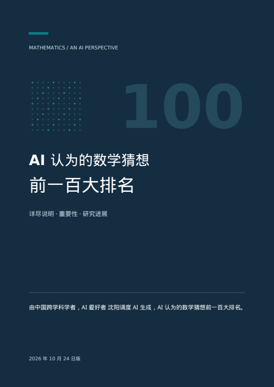

# AI 认为的数学猜想前一百大排名：详尽说明

**详尽说明 · 重要性 · 研究进展**  
中文 · 124 页 · **2026 年 10 月 24 日版**

> 由中国跨学科学者，AI 爱好者 沈阳调度 AI 生成，AI 认为的数学猜想前一百大排名。

[**在线阅读 PDF**](AI_Top_100_Mathematical_Conjectures_CN.pdf) · [**下载原版 PDF**](https://github.com/ziyor-ai/AI-Top-100-Mathematical-Conjectures/raw/refs/heads/main/AI_Top_100_Mathematical_Conjectures_CN.pdf) · [**浏览完整排名**](CATALOG.md)

本项目发布上述成果的中文原版 PDF。从数学基础性、跨领域联系、潜在理论后果及科学与计算影响出发，文档对 **100 项数学猜想、开放问题与猜想体系**作编辑性排序。每个条目介绍命题与范围、直观意义与重要性、研究进展、AI 辅助方向及易混淆之处，并附可点击的目录、领域索引、阅读路径和参考资料。

<p align="center">
  <a href="AI_Top_100_Mathematical_Conjectures_CN.pdf"></a>
</p>

## 阅读入口

| 内容 | PDF 页码 |
| --- | --- |
| 封面、编制说明、排序方法与状态标记 | 1–4 |
| 完整排名 | 5–9 |
| 100 个详细条目 | 10–109 |
| 领域索引 | 110–111 |
| 阅读路径 | 112 |
| 参考资料 | 113–124 |

PDF 内的目录、相关条目和文末来源可点击跳转。仓库另提供 [Markdown 版完整目录](CATALOG.md)，便于在线浏览和检索；正文及来源说明以 PDF 为准。

## 如何理解这份排名

- **编辑性排序**：名次来自 AI 对重要性的判断，不代表数学界投票、学术共识或可精确测量的客观评分，也不是 AI 最容易攻克的题目排名。
- **条目口径**：同时收录单一猜想、开放问题及有代表性的猜想体系；部分合并列项，因此 100 项并非 100 个互不重叠的原子命题。
- **排名与状态分开**：保留历史重要性位置，同时区分未解、部分结果、新结论跟踪、争议声明及近期证明文献，不能将本册称为“100 个均已确认仍未解决的猜想”。
- **证据边界**：稿件公开、形式化检查、专家复核与广泛接受是不同层次；本册没有独立重证或逐行验证全部研究声明。AI 辅助方向属于编辑建议。

研究状态按照原版日期及原文说明记录；本次 GitHub 发布不构成对后续研究进展或学界接受度的重新核验。

## 文件

| 文件 | 说明 |
| --- | --- |
| [AI_Top_100_Mathematical_Conjectures_CN.pdf](AI_Top_100_Mathematical_Conjectures_CN.pdf) | 用户提供的中文原版 PDF，原样发布 |
| [CATALOG.md](CATALOG.md) | 从原书第 5–9 页整理的 100 项目录 |
| [cover.png](cover.png) | 从原版 PDF 第 1 页渲染的封面预览 |
| [SHA256SUMS](SHA256SUMS) | 原版 PDF 的 SHA-256 校验值 |

```sh
shasum -a 256 -c SHA256SUMS
```

## 引用信息

沈阳（调度 AI 生成），《AI 认为的数学猜想前一百大排名：详尽说明》，2026 年 10 月 24 日版。

```text
沈阳（调度 AI 生成）. AI 认为的数学猜想前一百大排名：详尽说明.
2026-10-24.
https://github.com/ziyor-ai/AI-Top-100-Mathematical-Conjectures
```

## English overview

**AI's Top 100 Mathematical Conjectures: Detailed Explanations** is a 124-page Chinese-language publication directed by Shen Yang and generated by AI, dated 24 October 2026. It offers an editorial importance ranking of 100 conjectures, open problems, and conjecture families, with research-status notes, suggested AI-assisted directions, and references. The ranking is not a community consensus or a list of 100 uniformly unsolved problems. Only the Chinese edition is included in this repository.
